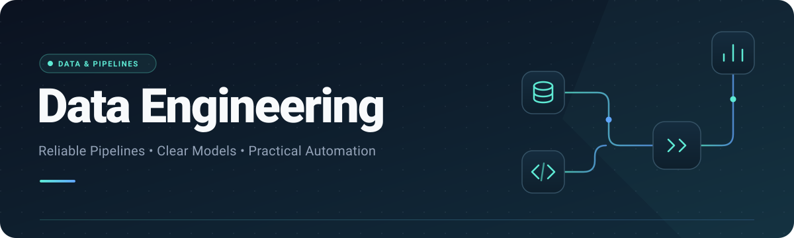

  

    

  
  &nbsp;&nbsp;
  

 

## 👨‍💻 About Me

I'm **Lucas Inocencio**, a **Data Engineering Intern** and **Computer Engineering Student**. I specialize in designing and maintaining reliable data pipelines, automated workflows, and structured data models that turn raw information into dependable business insights.

- 🚀 **Currently Building** — Resilient ETL/ELT pipelines, SQL analytical workflows, and automated validation gates.
- 📚 **Focus Areas** — Distributed data processing (Spark), workflow orchestration (Airflow), and scalable warehouse architectures.
- 🎯 **Core Values** — Data quality, repeatable tests, clean architecture, and transparent technical documentation.

---

## 🛠️ Tech Stack & Toolbox

### 💻 Languages & Data Processing

  
  
  
  

### ⚙️ Big Data & Orchestration

  
  
  

### 🗄️ Databases & Analytics

  
  
  

### 🔧 Tools & Environment

  
  
  
  

---

## 📬 Connect With Me

Always interested in collaborating on data engineering challenges, distributed architectures, and pipeline automation!

- 💼 **LinkedIn**: [linkedin.com/in/lucas-inocencio](https://www.linkedin.com/in/lucas-inocencio/)
- ✉️ **Email**: [lucas.inocenciod@gmail.com](mailto:lucas.inocenciod@gmail.com)
